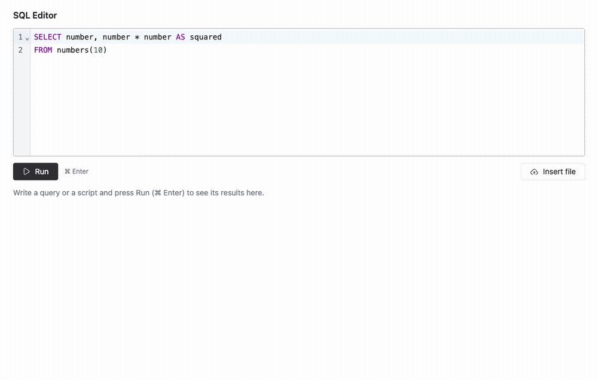
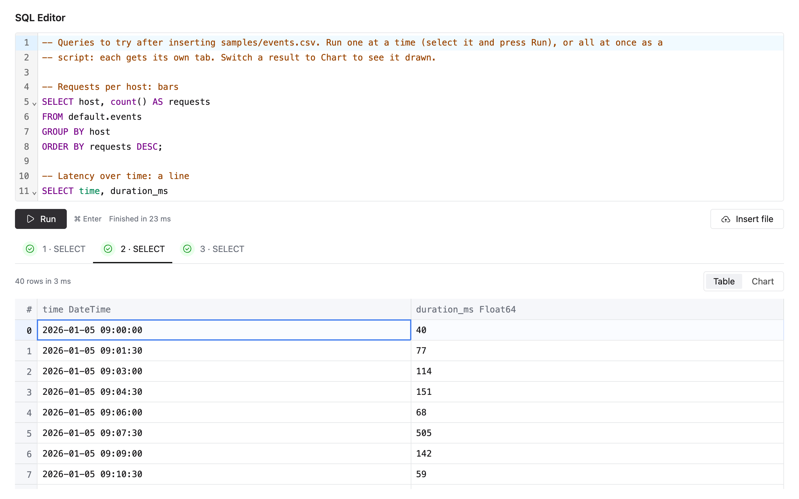
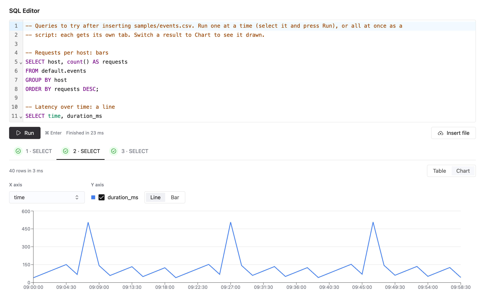
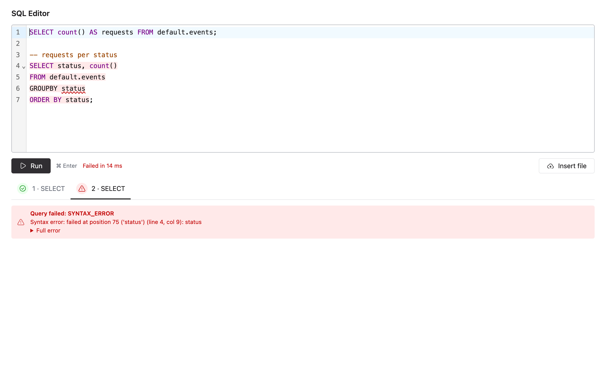
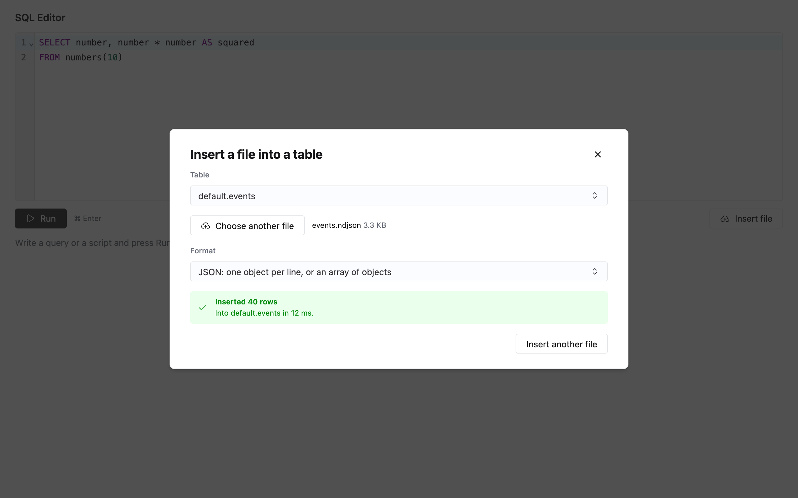

# Mini SQL editor for ClickHouse

A personal project exploring what a mini SQL editor for ClickHouse takes. Write a query or a whole script, run it, and
see each statement's result as a table or a chart; insert data from a file. React in the browser, Express and
`@clickhouse/client` on the server: `npm run start` builds everything and serves it on http://localhost:8080.



## Quick start

Requires Docker with Compose, and Node 20+ (tested on 20.20 and 22.23).

```sh
docker compose up -d   # ClickHouse 24.6 on :8123
npm i
npm run start          # builds the React app, then serves it and the API on http://localhost:8080
```

Then try the files in [`samples/`](samples/):

1. Paste [`setup.sql`](samples/setup.sql) into the editor and press Run (⌘/Ctrl+Enter). It recreates `default.events`,
   so the app asks you to confirm first.
2. **Insert file** → `default.events` → [`events.csv`](samples/events.csv) (or `.ndjson`, `.parquet`): 40 rows.
   [`events-with-error.csv`](samples/events-with-error.csv) shows a failed insert.
3. Paste [`queries.sql`](samples/queries.sql) and press Run: a tab per statement. Switch a result to **Chart**, or
   select one query and press **Run selection**.

[`server/requests.http`](server/requests.http) walks through the API. Tests: `npm test` (needs ClickHouse), or `npm run test:unit` without Docker.

## Scope and how I built it

This project was a challenge for myself - decide what and how to build a mini SQL editor with a two day time constraint.
Requirements:
- be able to run a single query or a script
- be able to insert from file
- scaffold user profiles
- persist a run outside of the browser

I worked with Claude Code. I could have written a smaller version of this by hand, but I'd rather show how I've found myself actually
working in the past year+ as AI has become an increasingly ubiquitous tool in software. AI made the basics quick to get working, so my
time went where it doesn't reliably help by itself: deciding what a mini SQL editor should do, testing what it told me about ClickHouse
against a real server (several confident answers were wrong), spotting holes, and reviewing, questioning and reworking each change until
I could defend it. The parts beyond the basics (cancellation, surviving a reload, file insert, errors that say whose fault they are) are
what make this SQL editor a extensible working product rather than a demo.

## What it does

- **Queries and scripts.** One statement shows its result; a script gets a tab per statement, with its status. A
  script's statements run in order in one ClickHouse session (so `USE`, `SET` and temporary tables carry over), and
  stop at the first error.
  Results show column types, row count and time, and say when they were cut at 10,000 rows. Also runs just highlighted text.
- **Charts.** Any result with a numeric column can be viewed as a line or bar chart. The axes are suggested from the
  column types (a time column gives a line, a category gives bars); the x column, up to five series and the chart
  type can be changed.
- **Errors that point at the problem.** ClickHouse's own message, with the failed statement highlighted in the editor
  and, for a syntax error, the exact token.
- **Runs that outlive the page.** The server owns each run, so you can watch its progress and cancel it in ClickHouse, and reloading the page picks it back up.
- **A confirmation before deleting data** (`DROP`, `TRUNCATE`, `DELETE`, `ALTER … DELETE/UPDATE`), enforced by the
  server, not only the dialog.
- **Insert from a file.** CSV, TSV, JSON or Parquet, up to 100 MB, into an existing table, streamed to ClickHouse. A
  bad row is named in the error.

<p>
  
  
  
  
</p>

## Why it's built this way

Three larger choices were informed by my time at Coalesce, where we ran customers' SQL on their own warehouse (e.g. Snowflake):

- **Errors say whose fault they are.** A failure could come from the user's SQL, the warehouse or our server, and our
  logs never said which, so debugging meant wading through thousands of lines. Here every error carries a `fault`
  (`client`, `upstream` or `server`), and routine SQL mistakes are logged at info, not error. I added fault attribution there later
  on, and wished we'd had it from the start.
- **A query outlives the page.** Our build tab ran long, dependency-aware queries, but a refresh lost them and their statuses, even though they kept running on the warehouse, and they couldn't be cancelled without going to the warehouse directly. Here the server owns each run, so reloading picks it back up with its current status, and Cancel still stops it in ClickHouse.
- **A run's status must match reality.** I tracked down runs our cleanup tool marked as failed that went on to complete on the warehouse. Here, the ClickHouse client's default 30 s timeout could manifest the same issue: it reported a statement as failed while ClickHouse went on to actually finish it and write the rows. Now ClickHouse enforces each statement's time limit itself and the app waits 30 seconds longer, so what the app reports is what happened.

## How it works

```
Browser (React)                     Express server (:8080)                        ClickHouse (:8123)

editor  ── POST /api/runs ───────▶  tokenize/split + classify (shared/)
results ◀─ GET /api/runs/:id ─────  run store (in memory)
           (polled; 304 if same)    runner: one statement at a time ── main pool, 50 connections ──▶
Cancel  ── POST …/:id/cancel ────▶  KILL QUERY, as the same login  ── control pool ────────────────▶
Insert  ── POST /api/insert ─────▶  the file, streamed as it arrives ── insert pool, 5 connections ─▶
```

The browser starts a run, polls it (every 250 ms for 2 s, then every second) and can cancel it. The server owns the
run, so a reload or a dropped connection loses nothing, and every limit is enforced in one place: the run store.

| Endpoint                                        | What it does                                                                                                                |
| ----------------------------------------------- | --------------------------------------------------------------------------------------------------------------------------- |
| `POST /api/runs` `{ sql, confirmDestructive? }` | Starts a script → 202 with the run. 400 if it can't run, 409 to confirm destructive statements, 429 if too many are running |
| `GET /api/runs/:id`                             | The run's status, and each statement's result or error. An unchanged run is a 304                                           |
| `POST /api/runs/:id/cancel`                     | Stops the running statement; the rest are skipped                                                                           |
| `GET /api/tables`                               | The tables the caller can see                                                                                               |
| `POST /api/insert?database=&table=&format=`     | Streams the body into the table → `{ rows, elapsedMs }`                                                                     |

Errors are JSON, with ClickHouse's own message and code when ClickHouse rejected something: bad SQL or a bad login is
400/401/403, ClickHouse unreachable 502, too slow 504, a bug here 500 without internals. Every failure is logged with
its fault. For example, when ClickHouse was down during a run:

```
request failed {
  runId: '15d8b8f3-7631-4966-af43-bb8913842186',
  statement: 1,
  status: 502,
  fault: 'upstream',
  code: 'ECONNREFUSED',
  stack: 'AggregateError [ECONNREFUSED]: …'
}
```

<details>
<summary><b>ClickHouse behaviour the design depends on</b> (each reproduced on 24.6 before building on it)</summary>

- **Statements that return no rows must not go through `client.query`.** It appends `FORMAT …`. DDL and writes sent
  that way _run_, then fail to parse the empty response: a reported failure after a real side effect, which invites a
  second run. `SET`, `USE` and `INSERT … VALUES` fail outright. So each statement is classified before it's sent: those
  that return rows go through `query` (as `JSONCompact`, which includes column names and types), everything else
  through `command`. An unknown statement counts as returning no rows: a wrong guess then loses output, rather than
  reporting a false error after a write.
- **An error partway through a result arrives after `200 OK`**, appended to the body, and the client returns the rows
  before it as success. Statements that return rows run with `wait_end_of_query=1`, so ClickHouse reports the error.
- **Capping rows without rewriting the SQL.** `max_result_rows` with `result_overflow_mode=break` is block-granular (a
  cap of 10 returned 65,409 rows) and says nothing, and it stops once it _reaches_ the limit, so a block boundary
  landing exactly on it looks complete. The server asks for 10,001 rows, keeps 10,000, and knows exactly whether the
  result was truncated. No `LIMIT` is injected into the user's SQL.
- **Each HTTP request is its own session.** A run uses one `session_id` for all its statements.
- **A login can't be forwarded as headers.** `@clickhouse/client` sends its own `Authorization` header by default, and
  ClickHouse rejects a request that also has `X-ClickHouse-User` (code 516). The server turns `X-ClickHouse-User` and
  `X-ClickHouse-Key` into the query's login instead, and forwards other `X-ClickHouse-*` headers as they are.
- **Aborting the HTTP request doesn't stop the query in ClickHouse.** Cancel sends `KILL QUERY` with the caller's
  login. It's repeated (every 250 ms, up to 5 times), because a KILL that arrives before the query has registered
  matches nothing. It goes over its own connection pool: sharing the main one, a KILL waited behind the very queries it
  was cancelling. Killing your own query only needs `SELECT` on `system.processes`; a user without it gets a notice
  saying so.
- **A timeout must stop the work, not just the waiting.** With the client's default 30 s timeout, a 40 s
  `INSERT … SELECT` was reported as failed, then wrote all its rows. Each statement is now sent with
  `max_execution_time` (5 minutes) and the client waits longer, so ClickHouse stops the statement and says so.
- **Scripts must be split by the app** (ClickHouse rejects several statements in one request). The splitter is a small
  lexer for strings, quoted identifiers, comments (including nested `/* */` and `#`) and heredocs, not a SQL parser:
  ClickHouse stays the judge of syntax, and its errors reach the user unchanged. ClickHouse's own `@clickhouse/parser`
  was evaluated and left out: 17 MB, version 0.x, and it replaces ClickHouse's error messages with its own.
- **Syntax-error positions are UTF-8 byte offsets**, counted from the start of the statement; the editor converts
  them to find the token.
- **Inserts aren't all-or-nothing.** Rows are written in blocks of about a million; a bad row after the first block
  leaves the rows before it in the table. The insert dialog warns when the failed row is past that point.
- **Every query is tagged** with `log_comment` (`{"app":"sql-editor","runId":…,"index":…}`), so a run's queries can
  be found in `system.query_log`.

</details>

```
server/    Express: api.ts (routes), runStore.ts, runner.ts, statement.ts (ClickHouse's HTTP rules), insert.ts,
           errors.ts (status and fault), clickhouseRequestOptions.ts (logins); integration/ needs ClickHouse
shared/    Used by both sides: the lexer, statement splitter and classifier, the API's types
client/    React: App, useRun (start, poll, cancel, resume), editor/, results/ (grid and chart), insert/
samples/   A table, data files in each format, queries to try
```

## Logins and security

- **ClickHouse users are the identities.** With `X-ClickHouse-User` and `X-ClickHouse-Key`, queries run as that user, with that user's grants (governed by ClickHouse, not this server). Without them, queries run as `default`, the local Docker setup's passwordless user: fine locally, not in a deployment. The UI always uses `default`; to try other users, create them in ClickHouse and call the API with their credentials (see `requests.http`).
- **A run belongs to the login that started it.** Polling or cancelling it with other credentials is a 404, and run ids are random UUIDs.
- **The destructive-statement confirmation guards against accidents; grants are the security.**

## Limitations

- **Runs live in memory, in one process.** Restarting the server loses them, and a second instance wouldn't see them. Finished
  runs are kept for 15 minutes, or until their slot is needed.
- **Fixed limits** (constants): 50 runs in progress, 5 per login; 200 statements and 1 MB per script; 10,000 rows and
  5 minutes per statement; files up to 100 MB. Uploads share 5 connections across all logins: more wait their turn
  (the browser's upload stalls meanwhile), and one login can take all five.
- **A changed run is sent whole.** Polling an unchanged run is nearly free (a 304, decided by the run's version
  number), but each change re-sends every result so far, so a long script with big results sends its early rows again.
- **Large inserts can be partial** (past about a million rows); the dialog warns, but can't undo it.
- **A script's `SET max_execution_time` is overridden** by the 5-minute limit; a statement's own `SETTINGS` clause
  still works.
- **One 2.5 MB JavaScript bundle** (718 KB gzipped); lazy-loading the chart would be the first split.
- **Smaller things:** grid row numbers start at 0 (click-ui's Grid); 64-bit integers lose precision beyond 2^53 on a
  chart (the grid shows them exactly); the editor's syntax highlighting is close to ClickHouse's, but not exact.

## Testing

`npm test` runs all 351 tests: unit and component tests (`npm run test:unit`, no Docker needed) and integration tests
against the real ClickHouse (`npm run test:integration`). `npm run typecheck` checks everything. The tests use Node's
built-in runner with supertest, and React Testing Library on jsdom.

- Every ClickHouse behaviour above was reproduced on 24.6 before building on it, and the key tests were checked by
  breaking the code and watching them fail.
- jsdom has no layout, so [`testSetup.ts`](client/src/testSetup.ts) stubs element sizes and text measurement. What
  depends on real layout (how many bars fit, axis labels, the virtualized grid) was checked in Chrome, along with every
  state, a reload mid-run and cancelling.
- Performance choices were measured: `memo` on the results panel halved the script time per keystroke with 10,000
  rows on screen.

## What I'd do next

- **Poll a small status, fetch results once**, so a change doesn't re-send earlier results.
- **Query history and saved queries.** Every query is already tagged in `system.query_log`.
- **Per-login limits for uploads, and a login for everyone.** Uploads would get what runs have: a per-login cap, and a 429 before any of the file is read, instead of waiting for a shared connection. Per-login limits only mean something when each person has their own login, so requests without credentials would be refused rather than run as `default` (allowed only by a local-development setting), with a "Connect as" form in the UI.
- **Create a table from a file**, using ClickHouse's schema inference.
- **Several server instances**: runs in a shared store such as Redis, and cancel by query id from any instance.
- **Friendlier wording for common ClickHouse errors** (memory limit, too many simultaneous queries).

## License

[MIT](LICENSE)
